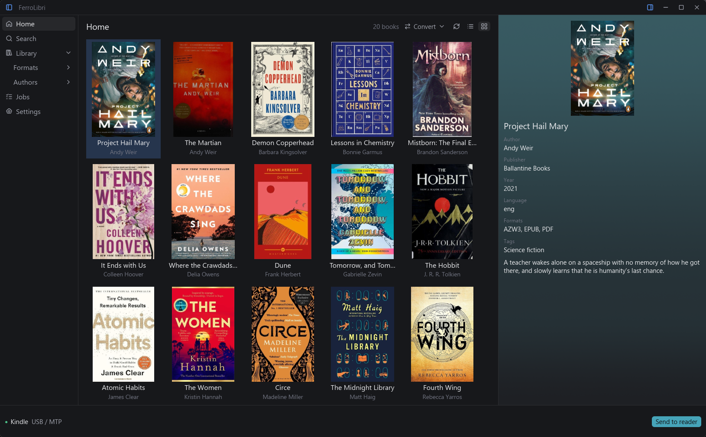

# FerroLibri

I got tired of Calibre's old, complex interface and its heavy storage footprint. All I really needed was a way to browse my library and transfer books to my e-reader, so I built a lightweight, drop-in replacement that works with your existing Calibre library structure. I also added things I found lacking or too complicated to use in Calibre, like instant book search.



## Install

FerroLibri is not published on crates.io (it depends on two patched iced crates kept in `vendor/`, see [vendor/README.md](vendor/README.md)); build it from source (see [Build from source](#build-from-source)):

```
cargo install --path crates/ferrolibri-ui
ferrolibri
```

On first run, you'll be prompted for your Calibre library path. The path is saved to your system default config path.

### Uninstall

```
cargo uninstall ferrolibri-ui
```

## Desktop UI

FerroLibri is a native desktop client built with [iced](https://iced.rs) (crate `crates/ferrolibri-ui`, executable `ferrolibri`). It browses the library as a list or a cover grid, searches live, shows metadata, converts, and sends books to a connected reader with a progress bar and a queue. FerroLibri never writes to the Calibre library itself; the only way a book gets in is through Calibre's own `calibredb` (see [Plugins](#plugins-search-sources)).

Run it from a checkout (Rust 1.93.1; on Linux install the Wayland/X11, xkbcommon and Vulkan development packages listed in [`.github/workflows/ui.yml`](.github/workflows/ui.yml)):

```
cargo run -p ferrolibri-ui --release
```

- **Platforms:** built, linted and tested in CI on Windows, Ubuntu 24.04 and macOS. It has only been run by hand on Windows 11. Window blur is Windows-only; other systems get an opaque window.
- **External tools:** none to browse, search or send an existing compatible file. Conversion needs Calibre's `ebook-convert` and/or [kepubify](https://pgaskin.net/kepubify/).
- **Keyboard:** `/` search, arrows move, Shift extends, Ctrl+A selects all, `T` sends, `C` opens Convert, Ctrl+B / Ctrl+I toggle the panes, Esc closes or clears.
- **Not supported:** network readers, MTP outside Windows, a light theme, metadata editing, a right-click context menu. Checked by hand on a real reader only with a Kindle Paperwhite Signature Edition over MTP on Windows (detection, send, byte-for-byte read-back and cancellation); readers that mount as a USB drive (Kobo, Kindle) are covered by fixture folders in tests, not by real devices.

## Features

- Browse all books in your Calibre library sorted by author and title, as a list or a cover grid
- Search/filter with `/` across author, title, and format
- Detail panel showing metadata parsed from `metadata.opf` (title, author, publisher, date, language, series, tags, description, identifiers)
- Convert books between formats (`C`) using [kepubify](https://pgaskin.net/kepubify/) or Calibre's `ebook-convert`
- Send books to a connected e-reader (`T`) — auto-detects Kobo and Kindle mounts and, on Windows, readers connected over MTP
- Search more sources and download books with plugins (see [Plugins](#plugins-search-sources))

## What gets scanned

The scanner walks `{library}/{author}/{title (id)}/` directories and recognizes AZW3, DOCX, EPUB, KEPUB, MOBI, PDF and TXT. Extensions are case-insensitive; `.kepub.epub` is distinct from EPUB. Unknown formats (including CBZ), covers, OPF and temporary files are not book inputs. Each book has a stable ID and an ordered list of exact file paths.

Excluded from scanning:
- `.caltrash/`, `.calnotes/`, `.DS_Store`, `downloaded/` (Calibre internal)
- `metadata.opf`, `cover.jpg` inside book folders

## Book conversion

Press `C` on a selected book to convert it to another format. Conversion options are shown based on which tools are installed:

- **kepubify** — used for EPUB → KEPUB conversion. Install from [pgaskin.net/kepubify](https://pgaskin.net/kepubify/)
- **ebook-convert** (Calibre) — used for other supported routes. KEPUB output is offered only when the installed tool's capability probe succeeds. Included with [Calibre](https://calibre-ebook.com/)

Only formats you don't already have are offered. If neither tool is installed, the convert dialog will let you know.

FerroLibri never writes to the Calibre library itself: it never imports conversions into it or changes `metadata.db`, OPF, covers or source books. (The one exception is adding a downloaded book through `calibredb`, see [Plugins](#plugins-search-sources).) Conversion results live in a separate temporary workspace owned by the application; retain/export them before exiting if needed. Explicit core output directories must be outside the library. Existing output files produce a conflict error.

## Readers and core API

Detection enumerates mounted local filesystems on Windows, Linux and macOS and checks reader signatures. A volume label or a `documents` directory alone does not identify a reader. Kobo prefers existing KEPUB, then EPUB; Kindle prefers AZW3, then MOBI and can prepare AZW3 using Calibre. On Windows, readers connected over MTP are detected through the Windows portable-device API and receive books directly; on Linux and macOS MTP is unavailable (FUSE-mounted MTP is deliberately ignored), and network storage is unsupported everywhere.

The core supports explicit selection by device ID and `device::manual_device(path, kind)` for a validated mount root. The UI automatically selects a single recognized reader. With several readers it asks you to choose one and offers manual folder selection (not for MTP readers, which have no folder). Multiple readers without a prior selection require explicit selection through the core API.

Transfers copy into a temporary file on the destination and publish without overwriting. Cancellation and write failures are reported; if disconnection prevents cleanup, the error includes the partial file path. Root mount points are never recreated.

Core operations return typed `Error`/`ErrorKind`; scans separate root errors from per-book warnings. Missing OPF uses directory metadata, while corrupt OPF is an error. `JobExecutor` runs scans, metadata, conversion and transfers on bounded worker threads, exposes job IDs, states and events, and supports cancellation. Copy progress reports bytes; converter progress reports stages. Shutdown cancels work and joins workers, but may wait for an uninterruptible OS call.

## Verification

With Rust 1.93.1:

```powershell
pwsh -File scripts/check-readiness.ps1
pwsh -File scripts/check-ui.ps1
```

`check-readiness.ps1` runs the core and plugin tests, strict Clippy and the native volume enumeration smoke; `-RealConverters` additionally tests installed Calibre with a synthetic TXT → EPUB → KEPUB conversion, and `-Ui` also runs `check-ui.ps1`. The iced UI has its own workflow (`ui.yml`: build, Clippy, tests with a headless UI simulator, real-core send/cancel/conflict flows, and a release build of the whole default workspace) on Windows, Ubuntu 24.04 and macOS. CI uses fixture folders as readers; the opt-in `#[ignore]` tests that need an attached MTP Kindle, Calibre or the internet are run by hand.

## Build from source

The workspace holds the core library, the plugin runtime and the [desktop UI](#desktop-ui). `cargo build --release` builds all of them; the executable is `ferrolibri`.

```
cargo run -p ferrolibri-ui --release
```

or `cargo install --path crates/ferrolibri-ui` to install `ferrolibri`. It is not published on crates.io (it depends on two patched iced crates kept in `vendor/`, see [vendor/README.md](vendor/README.md)).

## Plugins (search sources)

The desktop UI can search more than your library. **Plugins** add sources to the Search screen: a plugin asks a website or catalog and returns results, which FerroLibri draws itself; when a result offers a file, a download icon appears, and a click downloads the book and adds it to your Calibre library.

* **Install:** Settings → Plugins → *Install plugin…* — from a folder, or from a web address such as a GitHub repository (its releases are listed and checked for compatibility before anything is downloaded). A plugin is two files, `plugin.toml` and `plugin.js`. It runs in a sandbox and reaches only the sites it declares, which the install dialog lists.
* **Adding books needs Calibre.** A downloaded book goes into the library through Calibre's `calibredb` command, so Calibre has to be installed; without it you can still search and open the page of a result. Books are never written to the library any other way.
* **Examples:** [`examples/plugins/`](examples/plugins/README.md) has three: Open Library, Google Books (data only) and an OPDS catalog (Project Gutenberg, public-domain books, with downloads).
* **Writing a plugin:** see the [plugin author's guide](docs/PLUGINS.md). The `ferrolibri-plugin-check` tool checks a plugin folder (manifest, compatibility, a real `search`, the number of requests and the time it took):

  ```
  cargo run -p ferrolibri-plugins --bin ferrolibri-plugin-check -- examples/plugins/open-library --query dracula
  ```

### Disclaimer

FerroLibri's plugin interface is a neutral tool: it lets a program you install ask a website or catalog you choose and show the answer. The project does not provide, review, endorse, host or support third-party plugins, keeps no registry of them, and has no control over the sites they ask or the files those sites offer. The plugins and instructions in this repository are for sources that publish their catalogs for programs to use and offer books lawfully (Open Library, Google Books, and Project Gutenberg's public-domain collection); the project does not accept plugins or instructions for sites that distribute books without the right to do so.

You install and run a plugin at your own risk and are responsible for what you search for, download and add to your library: copyright and a site's terms of use differ from country to country and from site to site, and it is for you to make sure you may download or use a book. The software is provided "as is", without warranty of any kind (see the MIT License); the authors are not liable for what a third-party plugin does, for any damage it causes, or for the use of any plugin or source.

## Credits and license

FerroLibri is based on the core of [Rulibre](https://github.com/Glydric/Rulibre) by Leonardo Migliorelli (MIT). It is an independent project with its own name, iced UI and core changes; it is not affiliated with or endorsed by the original author.

Released under the [MIT License](LICENSE), which keeps the original copyright notice. The vendored iced crates in `vendor/` keep their own MIT license ([`vendor/LICENSE-iced`](vendor/LICENSE-iced)). Other dependencies are used unmodified under their own licenses (mostly MIT/Apache-2.0; a few crates are MPL-2.0).
